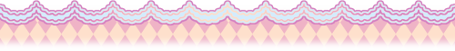
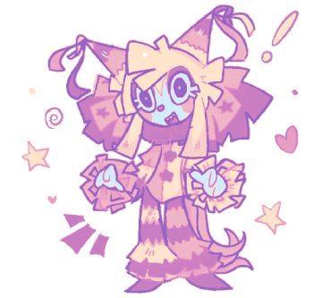

wip forever bcus im retheming

&nbsp;

&nbsp;

  

  
 &nbsp; &nbsp; &nbsp; &nbsp; &nbsp; &nbsp; &nbsp; $\color{#ce80c2}{\text{kenzi}}$ &nbsp; &nbsp; &nbsp; $\color{#efb5c6}{\text{or}}$  &nbsp; &nbsp; &nbsp; $\color{#ffe4cc}{\text{yatta}}$ &nbsp; &nbsp; $\color{#ce80c2}{\text{◡◡}}$ 
 
 $\color{#ce80c2}{\text{6teen , }}$ $\color{#ce80c2}{\text{<14 and}}$ $\color{#efb5c6}{\text{20+ dni /}}$ $\color{#ffe4cc}{\text{iwec}}$  

 &nbsp;&nbsp;&nbsp;&nbsp;&nbsp;&nbsp; $\color{#ce80c2}{\text{cudcomf}}$ $\color{#efb5c6}{\text{,}}$ $\color{#efb5c6}{\text{w2i}}$ $\color{#ffe4cc}{\text{pref}}$

&nbsp;&nbsp;&nbsp;&nbsp;&nbsp;&nbsp;&nbsp;&nbsp;&nbsp;&nbsp;&nbsp;&nbsp;&nbsp;&nbsp;&nbsp;&nbsp;&nbsp;&nbsp;&nbsp;&nbsp;&nbsp;&nbsp;&nbsp;&nbsp;&nbsp;&nbsp;&nbsp;&nbsp;&nbsp;&nbsp;&nbsp;&nbsp;   $\color{#ce80c2}{\text{𐂯}}$
  
 $\color{#ce80c2}{\text{social}}$  $\color{#ce80c2}{\text{anx}}\color{#efb5c6}{\text{iety}}$  $\color{#efb5c6}{\text{+}}$  $\color{#efb5c6}{\text{susp}}\color{#ffe4cc}{\text{ected}}$  $\color{#ce80c2}{\text{ad}}\color{#efb5c6}{\text{hd}}$
  
&nbsp;         
  
&nbsp;

&nbsp;

&nbsp;

&nbsp;
&nbsp;
&nbsp;
&nbsp;
&nbsp;
&nbsp;
&nbsp;
&nbsp;
&nbsp;
&nbsp;
&nbsp;
&nbsp;

  
  

    

 [@pt-fashion](https://github.com/pt-fashion) [@pt-hall-of-media](https://github.com/pt-hall-of-media) [@pt-walk-of-fame](https://github.com/pt-walk-of-fame) [@ponytowns-ships](https://github.com/Ponytowns-ships) [pt-heavyfictkin](https://github.com/pt-heavyfictkin) [kaotown](https://github.com/kaotown) [ponytowns-rewards](https://github.com/Ponytowns-rewards) [piddlesjet](https://github.com/piddlesjet) [NO[LI]MINATIONS
](https://github.com/THE-TEMPIST) [animal-town](https://github.com/animal-town) 

  PARTYPUPPYY = old user

[ata](https://z0mbiepup.atabook.org) [prns.cc](https://pronouns.cc/@zombiepup)

